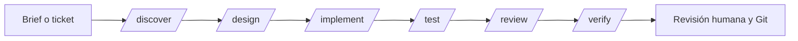

# Desarrollo asistido por IA: decisiones y forma de trabajo


Este documento explica cómo usamos agentes, comandos y skills en el día a día.
La intención es que el trabajo asistido por IA sea **predecible, revisable y
repetible**, no una colección de prompts personales.

---

## 1. Principios

1. **El contrato manda.** El código se escribe contra requisitos y criterios de
   aceptación explícitos, no contra la intuición del modelo.
2. **Separación de funciones.** Quien implementa no es quien escribe los tests
   principales ni quien revisa. La independencia es parte del control.
3. **Evidencia antes que opinión.** Un cambio está terminado cuando los tests,
   los logs o la prueba de carga lo demuestran.
4. **Contexto acotado.** Los subagentes arrancan sin contexto. Se les da un
   slice pequeño, con archivos, contrato y criterio de done.
5. **Sin escrituras autónomas en Git.** Ningún agente hace commit, push ni crea
   ramas. Esa decisión es humana.
6. **Seguridad por defecto.** No se pegan secretos, credenciales ni datos
   personales en prompts, issues o documentación.

---

## 2. Topología de agentes

| Agente | Modo | Responsabilidad | Permisos | Cuándo usarlo |
|---|---|---|---|---|
| `engineering-lead` | primary | Diseña el slice, escribe código de producción, integra y valida. Es el dueño del cambio. | Edición y shell. | Implementación principal y coordinación. |
| `backend-engineer` | subagent | Implementa un slice acotado con especificación cerrada. | Edición y shell; no modifica `tests/`. | Cuando el slice es independiente y tiene contrato claro. |
| `test-engineer` | subagent | Escribe y mantiene tests desde el contrato, no desde la implementación. | Edición solo en `tests/`; shell limitado a tests y git de inspección. | Antes o en paralelo a la implementación. |
| `software-architect` | subagent | Revisa límites, NFRs, ADRs, trade-offs y deuda. | Solo lectura y git de inspección. | Antes de cerrar un diseño o un cambio grande. |
| `reliability-reviewer` | subagent | Audita concurrencia, colas, reintentos, idempotencia, timeouts y operación. | Solo lectura y tests. | Antes de releases y cambios en el pipeline. |

### Por qué el `engineering-lead` escribe la mayor parte del código

Los subagentes tienen contexto fresco y no ven la conversación previa. Delegar
un cambio abierto produce retrabajo y decisiones inconsistentes. Por eso el
`engineering-lead` mantiene el hilo y delega solo slices con contrato cerrado.

### Por qué los revisores no editan

Si un revisor escribe código, deja de ser un control independiente. Los
revisores producen hallazgos; el `engineering-lead` decide y aplica.

---

## 3. Comandos

| Comando | Agente | Salida esperada |
|---|---|---|
| `/discover` | `engineering-lead` | Requisitos, NFRs, criterios de aceptación, riesgos y preguntas abiertas. |
| `/design` | `engineering-lead` | Contexto, límites, opciones, decisión, ADR y failure modes. |
| `/implement` | `engineering-lead` | Slice vertical implementado y tests ejecutados. |
| `/test` | `test-engineer` | Tests nuevos o ampliados, con gaps reportados. |
| `/review` | `engineering-lead` + subagentes | Hallazgos de arquitectura y fiabilidad, priorizados. |
| `/verify` | `engineering-lead` | Evidencia de tests/carga y trazabilidad contra criterios. |

Los comandos son genéricos: el contexto del proyecto se pasa como argumento o
se lee de `AGENTS.md` y `docs/`. No contienen lógica de negocio de este servicio.

El proyecto usa `engineering-lead` como agente primario por defecto. `build`
sigue disponible para tareas generales que no requieran el flujo anterior.

### Flujo recomendado



**Regla práctica:** si el cambio es pequeño y el contrato ya está claro, se
puede saltar de `implement` a `verify`. Si el cambio toca concurrencia,
persistencia o integración externa, `design` y `review` no son opcionales.

---

## 4. Skills

| Skill | Se carga cuando... | Aporta |
|---|---|---|
| `requirements-engineering` | Hay un brief ambiguo o falta matriz de aceptación. | Separar problema de solución, NFRs medibles, riesgos e invariantes. |
| `solution-architecture` | Hay que elegir estructura, límites o trade-offs. | Contexto, opciones, ADR, failure modes y evolución. |
| `llm-output-contracts` | Se integra un LLM en un sistema tipado. | Contrato de prompt, parseo por capas, validación, fallback y evals. |
| `reliability-hardening` | Hay queues, workers, reintentos o límites de tasa. | Checklist de backpressure, idempotencia, timeouts y apagado. |

Las skills contienen **proceso**, no detalles de este servicio. Así se pueden
reutilizar en otro backend, otro proveedor o incluso otro lenguaje.

### Cómo añadir una skill

1. Crear `.opencode/skills/<id>/SKILL.md`.
2. Añadir frontmatter con `name` y `description` claros.
3. Escribir pasos, checklist y ejemplos de salida.
4. Si la skill crece, mover plantillas a `references/` o `templates/`.
5. Probar que otro agente puede seguirla sin contexto adicional.

---

## 5. Decisiones de desarrollo IA

### ADR-AI-001: el agente principal es el dueño del cambio

**Decisión.** El `engineering-lead` mantiene el contexto, integra el cambio y
responde por el resultado. Los subagentes se usan para slices acotados.

**Consecuencias.** Menos fragmentación y decisiones más coherentes. A cambio,
el agente principal necesita más contexto y debe delegar con especificaciones
precisas.

### ADR-AI-002: los tests principales los escribe `test-engineer`

**Decisión.** El implementador no escribe los tests que validan su propio
trabajo; puede ejecutarlos y añadir pruebas unitarias de apoyo.

**Consecuencias.** Los tests reflejan el contrato, no los supuestos del autor.
A cambio, hay coordinación adicional y el contrato debe estar claro antes de
empezar.

### ADR-AI-003: revisores de solo lectura

**Decisión.** `software-architect` y `reliability-reviewer` no editan archivos.

**Consecuencias.** Sus hallazgos son independientes. El coste es que el
`engineering-lead` debe aplicar las correcciones.

### ADR-AI-004: skills genéricas y contexto en el repositorio

**Decisión.** Las skills describen procesos reutilizables. El conocimiento del
dominio vive en `AGENTS.md`, `docs/` y el código.

**Consecuencias.** Las skills se pueden copiar a otro proyecto. A cambio, hay
que mantener la documentación del proyecto actualizada.

### ADR-AI-005: Git es responsabilidad humana

**Decisión.** Ningún agente hace commit, push ni crea ramas. La configuración
del proyecto bloquea esos comandos.

**Consecuencias.** El humano revisa y decide cuándo integrar. A cambio, se
pierde algo de automatización en el cierre de tareas.

### ADR-AI-006: la evidencia es parte del done

**Decisión.** Un cambio no se considera terminado sin tests ejecutados y, si
aplica, evidencia de carga o de comportamiento operativo.

**Consecuencias.** Más tiempo de verificación y menos regresiones. La evidencia
queda en la conversación, en logs o en el PR.

### ADR-AI-007: no se pegan secretos ni PII en prompts

**Decisión.** Se usan variables de entorno y datos sintéticos. Los logs tampoco
incluyen texto de usuario ni destinos.

**Consecuencias.** Menor riesgo de fuga. A cambio, depurar un caso real requiere
reproducirlo con datos anonimizados.

### ADR-AI-008: los prompts forman parte del código

**Decisión.** El `system prompt` vive en `app/notification/domain/prompt.py`, se
versiona y se prueba como cualquier otro contrato.

**Consecuencias.** Se puede revisar y evaluar. A cambio, cambios de prompt
requieren tests y revisión, no solo edición en caliente.

---

## 6. Cómo trabajar en una tarea

### 6.1 Antes de escribir código

- Leer `AGENTS.md`, `docs/architecture.md` y el módulo afectado.
- Identificar el contrato: entradas, salidas, estados, errores e invariantes.
- Escribir o localizar los criterios de aceptación.
- Decidir si el cambio necesita `design` y `review`.

### 6.2 Durante la implementación

- Hacer un slice vertical pequeño, no una capa completa sin comportamiento.
- Mantener los puertos y adaptadores existentes.
- No introducir dependencias sin justificar y fijar versión.
- No loguear PII ni secretos.
- Ejecutar los tests relevantes tras cada cambio.

### 6.3 Antes de cerrar

- Ejecutar la suite completa.
- Revisar logs de una petición de extremo a extremo.
- Comprobar que no hay secretos en el diff.
- Pasar `review` de arquitectura y fiabilidad si el cambio lo merece.
- Reportar evidencia y limitaciones conocidas.

### 6.4 Checklist de done

- [ ] El contrato y los estados siguen siendo correctos.
- [ ] Hay tests para el camino feliz y los fallos esperados.
- [ ] Los errores son tipados y no filtran detalles internos.
- [ ] No hay secretos, PII ni datos reales en código, tests o logs.
- [ ] La configuración nueva está documentada.
- [ ] El cambio se ha validado en local o en el stack de compose.
- [ ] No se ha hecho commit, push ni creado ramas.

---

## 7. Límites y riesgos del trabajo con IA

| Riesgo | Mitigación |
|---|---|
| El subagente pierde contexto. | Pasarle archivos, contrato y criterio de done; usarlo solo para slices acotados. |
| API inventada o dependencia inexistente. | Verificar con documentación, tests y ejecución real. |
| Tests que reflejan la implementación y no el contrato. | `test-engineer` escribe desde criterios de aceptación. |
| Revisor demasiado optimista. | Exigir hallazgos con archivo/línea y evidencia reproducible. |
| Prompt injection desde datos de usuario. | Instrucciones en `system`; el texto de usuario es dato no confiable. |
| Cambio de modelo o de proveedor. | Reejecutar evals y tests; no asumir compatibilidad. |
| Coste o latencia inesperados. | Medir con carga; revisar timeouts, reintentos y tamaño de prompt. |
| Deriva de documentación. | `docs/` se actualiza en el mismo cambio que el código. |

---

## 8. Incorporación rápida

1. Lee `AGENTS.md`.
2. Lee `docs/architecture.md` y este documento.
3. Ejecuta `python -m pytest -q`.
4. Revisa `.opencode/agents/`, `.opencode/commands/` y `.opencode/skills/`.
5. Elige una tarea pequeña y pasa `/discover` si el contrato no está claro.
6. Usa `/implement`, `/test`, `/review` y `/verify` según el riesgo.
7. Deja el árbol de trabajo limpio de secretos y sin commits automáticos.

### Ejemplo de petición

```text
/implement Añade un límite de longitud al mensaje extraído y tests para
mensajes vacíos, >1000 caracteres y caracteres de control.
```

El agente debe leer el contrato, localizar `guardrails.py`, implementar el
cambio, ejecutar los tests y reportar el resultado. No debe hacer commit.
