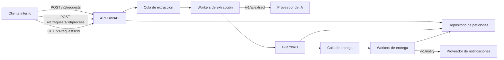
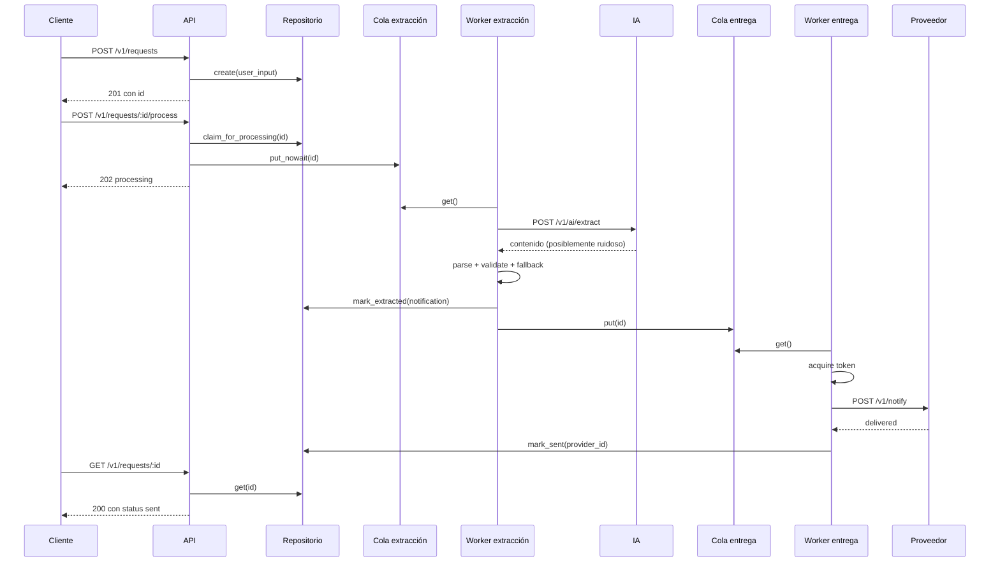
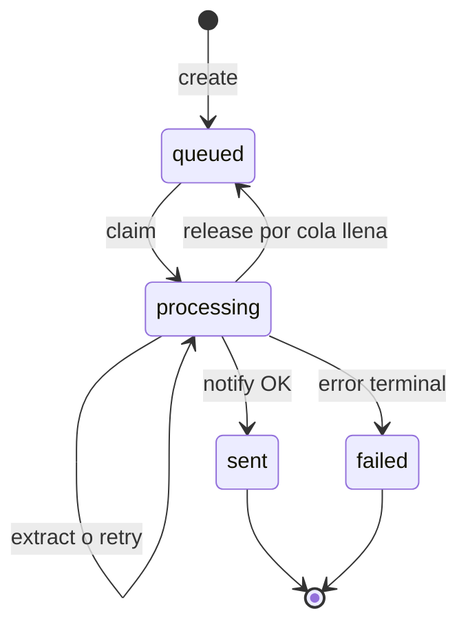

# Servicio de notificaciones: arquitectura y decisiones técnicas


Este documento explica qué hace el servicio, por qué está construido así y qué
trade-offs hemos aceptado. No es una guía de la prueba de integración: es la
documentación técnica del proyecto.

---

## 1. Resumen

El servicio recibe peticiones en lenguaje natural, extrae una notificación
estructurada mediante un motor de IA, valida y normaliza el resultado, y la
entrega a un proveedor de email o SMS. Expone una API HTTP y mantiene el estado
de cada petición.

La decisión central es **desacoplar la aceptación de la petición de su
procesamiento**. El endpoint de proceso responde `202 Accepted` en cuanto el
trabajo queda encolado. La extracción y el envío ocurren en segundo plano con
dos etapas independientes y colas acotadas.

Esto evita que la latencia del modelo (1,5–3 s en el proveedor actual) y el
límite de notificaciones (50 cada 10 s) contaminen la latencia de la API.

---

## 2. Contexto y límites



**Dentro del alcance**

- Ingesta de peticiones y consulta de estado.
- Extracción estructurada con IA y tratamiento de respuestas imperfectas.
- Validación, normalización y entrega de email/SMS.
- Reintentos, límite de tasa, backpressure y apagado ordenado.
- Logs estructurados, health checks y configuración por entorno.

**Fuera del alcance actual**

- Gestión de usuarios, plantillas o campañas.
- Persistencia durable entre reinicios.
- Garantía de entrega exactamente una vez a nivel de proveedor.
- Facturación, cuotas por cliente o multi-tenancy.
- Autenticación de clientes entrantes (se asume una red interna o gateway).

---

## 3. Requisitos funcionales y criterios de aceptación

| ID | Requisito | Criterio de aceptación |
|---|---|---|
| FR-1 | Crear una petición | `POST /v1/requests` devuelve `201` con un `id` no vacío. |
| FR-2 | Procesar una petición | `POST /v1/requests/{id}/process` devuelve `202` al encolar o `200` si ya estaba procesada. |
| FR-3 | Extraer datos | Se llama al motor de IA con un `system prompt` explícito y el texto original como mensaje de usuario. |
| FR-4 | Tolerar salidas imperfectas | JSON limpio, claves alternativas, Markdown, texto embebido, JSON truncado, comillas simples y claves sin comillas se recuperan o se rechazan con un error tipado. |
| FR-5 | Entregar notificaciones | Solo se llama al proveedor si la notificación es válida; el resultado se registra como `sent` o `failed`. |
| FR-6 | Consultar estado | `GET /v1/requests/{id}` devuelve uno de `queued`, `processing`, `sent`, `failed`. |
| FR-7 | Idempotencia | Llamar dos veces a `/process` no duplica la notificación. |
| FR-8 | Operación | `GET /health/live` y `GET /health/ready` permiten sondear el servicio. |
| FR-9 | Idempotencia de creación | Dos creaciones con la misma `Idempotency-Key` devuelven el mismo `id`. |
| FR-10 | Observabilidad | `GET /metrics` expone contadores, histograma HTTP y profundidad de colas. |
| FR-11 | Entrada limitada | Un cuerpo mayor que `MAX_REQUEST_BYTES` devuelve `413`. |

**Invariantes**

- Una petición solo puede pasar de `queued` a `processing` una vez.
- `sent` y `failed` son estados terminales.
- `GET` nunca expone el destinatario ni el contenido del mensaje.
- Un rechazo de política de la IA no se puentea con el extractor determinista.
- Una `Idempotency-Key` apunta a una única petición mientras el registro exista.

---

## 4. Requisitos no funcionales

| Área | Objetivo | Cómo se cubre |
|---|---|---|
| Latencia de aceptación | `POST /process` < 100 ms p95 | Solo se reclama la petición y se encola; no se espera al proveedor. |
| Throughput | Soportar ráfagas de 200 clientes concurrentes | Colas acotadas, workers independientes y respuesta inmediata. |
| Fiabilidad | No perder el proceso por un 429 o un 5xx | Reintentos con backoff y jitter; errores tipados; estado terminal explícito. |
| Backpressure | No crecer sin límite | Colas con tamaño máximo y `503` con `Retry-After` si la cola de extracción se llena. |
| Observabilidad | Diagnóstico por petición | `request_id` en logs JSON y en la cabecera `X-Request-ID`. |
| Seguridad | No filtrar secretos ni PII | API key por entorno; no se loguea el texto del usuario ni el mensaje. |
| Mantenibilidad | Sustituir infraestructura sin tocar dominio | Puertos `RequestRepository` y `NotificationProvider`. |
| Operación | Apagado sin corrupción | `lifespan` para arrancar y drenar workers con timeout. |

---

## 5. Arquitectura

### 5.1 Componentes

| Componente | Responsabilidad |
|---|---|
| `notification.api` | Contrato HTTP, validación de entrada, códigos de estado. |
| `SQLiteRequestRepository` | Estado durable local, transiciones atómicas e idempotencia de creación. `InMemoryRequestRepository` queda para tests. |
| `extraction_queue` | Cola acotada de peticiones pendientes de extracción. |
| `extraction_pool` | Workers que llaman a la IA y aplican guardrails. |
| `guardrails` | Parseo tolerante, canonicalización, validación y fallback determinista. |
| `delivery_queue` | Cola acotada de notificaciones listas para enviar. |
| `delivery_pool` | Workers que aplican el límite de tasa y llaman al proveedor. |
| `AsyncTokenBucket` | Limita el envío a 4,0/s con ráfaga de 8: 48/10 s, por debajo de 50/10 s. |
| `ProviderClient` | Cliente HTTP reutilizable, timeouts, reintentos y errores tipados. |
| `metrics` | Contadores, histograma HTTP y gauges de cola en formato Prometheus. |
| `WorkerPool` / `ServiceRuntime` | Ciclo de vida de workers, drenaje y apagado. |

### 5.2 Flujo de una petición



### 5.3 Máquina de estados



### 5.4 Estructura de módulos

```text
app/
├── main.py                     # composición, lifespan, middleware, errores
└── notification/
    ├── __init__.py
    ├── config.py               # Settings desde entorno
    ├── container.py            # dependencias de la aplicación
    ├── api/
    │   ├── __init__.py
    │   └── routes.py           # rutas y modelos HTTP
    ├── application/
    │   ├── __init__.py
    │   ├── ports.py            # interfaces y ProviderError
    │   ├── pipeline.py         # extracción y entrega
    │   └── runtime.py          # workers y ciclo de vida
    ├── domain/
    │   ├── __init__.py
    │   ├── models.py           # modelos, estados y errores
    │   ├── guardrails.py       # parseo y validación tolerante
    │   └── prompt.py           # contrato del system prompt
    ├── infrastructure/
    │   ├── __init__.py
    │   ├── provider.py         # adaptador HTTP y reintentos
    │   ├── rate_limit.py       # token bucket asíncrono
    │   ├── repository_memory.py
    │   └── repository_sqlite.py
    └── observability/
        ├── __init__.py
        ├── logging.py          # logs JSON
        └── metrics.py          # métricas Prometheus
```

---

## 6. Decisiones técnicas

### ADR-001: procesamiento asíncrono en dos etapas

**Contexto.** La IA tarda 1,5–3 s y el proveedor limita a 50 notificaciones
cada 10 s. Un `POST /process` síncrono acumularía latencia y mezclaría dos
cuellos de botella distintos.

**Decisión.** Responder `202` tras encolar y separar extracción y entrega en dos
colas y dos pools de workers.

**Consecuencias.**

- La API mantiene latencia baja y estable.
- El estado `processing` puede durar más que la petición HTTP.
- Si el proceso se reinicia, las colas en memoria se pierden. Es una limitación
  conocida, no un comportamiento accidental.
- El backlog de entrega es esperable bajo carga sostenida; el límite real lo
  impone el proveedor.

**Alternativas descartadas.**

- Procesar dentro del request: simple, pero acopla la latencia y desperdicia
  capacidad de extracción cuando la entrega está limitada.
- Un solo pool: los workers quedarían bloqueados esperando tokens de entrega.

### ADR-002: puertos para repositorio y proveedor; colas en memoria

**Contexto.** El dominio no debería depender de SQLite, de Postgres ni de
`httpx`. Las colas, en cambio, siguen siendo parte del runtime de este
despliegue.

**Decisión.** `RequestRepository` y `NotificationProvider` son protocolos.
`SQLiteRequestRepository` es el adaptador local por defecto;
`InMemoryRequestRepository` se usa en tests. Las colas son `asyncio.Queue`
gestionadas por `ServiceRuntime`.

**Consecuencias.**

- Cambiar SQLite por Postgres consiste en implementar el puerto y cambiar la
  composición en `main.py`; el dominio y la API no se tocan.
- Las colas siguen viviendo en un solo proceso.
- El estado sí sobrevive a un reinicio del proceso, pero el trabajo pendiente en
  cola no.
- Para multi-instancia hace falta un repositorio compartido y un broker.

**Evolución.** Postgres gestionado, broker (Redis Streams, SQS, RabbitMQ),
recuperación al arrancar y limitador de tasa distribuido.

### ADR-003: guardrails por capas con fallback determinista

**Contexto.** El motor de IA devuelve JSON limpio solo una parte del tiempo.
También puede devolver Markdown, texto embebido, JSON truncado, comillas
simples, claves sin comillas, campos ausentes o rechazos.

**Decisión.** Aplicar capas en este orden:

1. Extraer candidatos: bloques Markdown, objetos balanceados y texto completo.
2. Reparar: elipsis final, claves sin comillas, comas finales, cierre de JSON.
3. Cargar: `json.loads`, `ast.literal_eval` y reparación.
4. Canonicalizar claves: `to`/`recipient`/`destination`, `message`/`body`/`text`,
   `type`/`channel`/`method`.
5. Normalizar valores: email, teléfono, tipo y mensaje.
6. Validar con reglas de dominio.
7. Si la salida no es recuperable, intentar un extractor determinista desde el
   texto original.
8. Si la IA rechaza por política, **no** aplicar fallback: se marca `failed`.

**Consecuencias.**

- La tasa de extracción útil sube sin ocultar errores reales.
- El fallback es una degradación observable (`source=deterministic` en logs).
- El fallback no sustituye a la IA: solo se usa cuando la salida es inservible.
- Un rechazo de política se respeta y se registra como `ai_refused`.

### ADR-004: límite de tasa en cliente y reintentos en el adaptador

**Contexto.** El proveedor acepta 50 notificaciones por cada 10 segundos y
puede devolver `429` o `500`.

**Decisión.** Un token bucket de 4,0/s con ráfaga de 8 protege al proveedor. El
`ProviderClient` reintenta `429`, `5xx`, timeouts y errores de transporte con
backoff exponencial y jitter. Cada intento de entrega adquiere un token.

**Consecuencias.**

- Menos `429` provocados por nuestro propio tráfico.
- La entrega se vuelve el cuello de botella; el backlog se acumula en la cola de
  entrega.
- Los errores no reintentables (`401`, `403`, `422`) fallan rápido.
- No hay circuit breaker todavía; se documenta como evolución.

### ADR-005: contrato de prompt con instrucciones en el mensaje de sistema

**Contexto.** El texto del usuario es datos no confiables. Además, algunos
modelos pequeños o literales pueden confundir ejemplos del prompt con la
entrada real.

**Decisión.** El `system prompt` define rol, esquema, reglas, ejemplos y defensa
ante inyección. El mensaje de usuario contiene **solo** el texto original. Los
ejemplos viven en el sistema.

**Consecuencias.**

- El modelo no extrae direcciones de los ejemplos por accidente.
- El contrato es explícito y versionable en `domain/prompt.py`.
- La calidad del prompt se puede evaluar de forma independiente.
- Si se cambia el esquema, hay que actualizar prompt y guardrails a la vez.

### ADR-006: errores tipados y transiciones atómicas

**Contexto.** Bajo concurrencia, dos llamadas a `/process` o un worker lento
pueden competir por el mismo registro.

**Decisión.** El repositorio expone transiciones con lock (`claim_for_processing`,
`mark_extracted`, `claim_delivery`, `mark_sent`, `mark_failed`). Los errores se
clasifican con `ErrorCode`: IA no disponible, rechazo, respuesta inválida,
extracción fallida, rate limit, proveedor no disponible, proveedor rechaza,
error interno.

**Consecuencias.**

- `/process` es idempotente y no duplica notificaciones.
- `sent` y `failed` no se sobrescriben.
- El cliente y los dashboards pueden distinguir un fallo de política de un fallo
  técnico.

### ADR-007: logs JSON y health checks

**Contexto.** En un servicio asíncrono, el log de acceso HTTP no cuenta la
historia completa.

**Decisión.** Un middleware asigna `X-Request-ID`, mide latencia y emite una
línea JSON por petición. El pipeline emite eventos de extracción y entrega con
el mismo identificador. `health/live` y `health/ready` separan liveness de
readiness.

**Consecuencias.**

- Se puede seguir una petición entre API, extracción y entrega.
- No se loguean destinatarios, mensajes ni API keys.
- Las métricas Prometheus viven en `/metrics`; las trazas OpenTelemetry siguen
  pendientes y el formato JSON es compatible con una recolección posterior.

### ADR-008: configuración por entorno con valores locales seguros

**Contexto.** El servicio debe funcionar en local sin fricción y en producción
sin secretos en el repositorio.

**Decisión.** `Settings` se construye desde variables de entorno con defaults
locales. La API key del proveedor se inyecta por `PROVIDER_API_KEY`.

**Consecuencias.**

- El despliegue local funciona sin configuración adicional.
- Producción debe sobrescribir la API key y los límites.
- Los defaults están pensados para el proveedor de desarrollo, no para
  credenciales reales.

### ADR-009: idempotencia de creación y cabeceras operativas

**Contexto.** Un cliente puede reintentar `POST /v1/requests` después de un
timeout de red. Sin una clave de idempotencia, el reintento crea una petición
duplicada y puede producir una notificación duplicada.

**Decisión.** Aceptar una cabecera opcional `Idempotency-Key`. El repositorio
mantiene la relación clave → id. Si la clave ya existe, devuelve el mismo
registro con `200 OK`, `Idempotency-Replayed: true` y el mismo `Location`. En la
primera creación se devuelve `201` y `Location`. `GET` añade `Retry-After: 1`
mientras la petición está pendiente y `Cache-Control: no-store`.

**Consecuencias.**

- Los reintentos de creación no duplican trabajo.
- El mapa de idempotencia crece con el repositorio; en producción necesita TTL
  o persistencia con la misma retención que las peticiones.
- La respuesta de replay es `200`, no `201`; es la semántica habitual de
  idempotencia y el contrato admite ambos códigos.

### ADR-010: límite de cuerpo y cabeceras de seguridad

**Contexto.** La entrada es texto libre y el servicio está expuesto a clientes
internos, pero no queremos aceptar cuerpos arbitrariamente grandes ni facilitar
el sniffing de contenido.

**Decisión.** Rechazar cuerpos cuya `Content-Length` supere `MAX_REQUEST_BYTES`
(64 KiB por defecto) con `413`. Añadir `X-Content-Type-Options: nosniff`,
`X-Frame-Options: DENY`, `Referrer-Policy: no-referrer` y `Cache-Control:
no-store` en `/v1`.

**Consecuencias.**

- Se evita procesar cuerpos desproporcionados.
- `Content-Length` puede faltar en transferencias chunked; en producción el
  gateway debe imponer también el límite.
- Las cabeceras son defensa en profundidad, no sustituyen autenticación.

### ADR-011: métricas Prometheus, contenedor no-root y CI

**Contexto.** Los logs permiten diagnosticar una petición, pero no medir
tendencias ni saturación. Además, la imagen corría como root y no tenía
healthcheck propio.

**Decisión.** Usar `prometheus-client` y exponer `/metrics` con contadores de
creación, resultados terminales, fallos por código, fuentes de extracción,
reintentos y profundidad de colas, más un histograma HTTP etiquetado por
plantilla de ruta. La imagen corre con UID/GID `10001`, define un healthcheck y
`load-test` espera a que `app` esté healthy. Se añade un workflow de CI que
ejecuta la suite.

**Consecuencias.**

- Más señal operativa sin dependencia de un backend de métricas.
- Las etiquetas usan rutas normalizadas para evitar cardinalidad por `id`.
- `/metrics` queda en la red interna; en producción debe protegerse o aislarse.
- El CI no levanta Docker ni k6; la validación de carga sigue siendo manual.

### ADR-012: SQLite local y Postgres en producción

**Contexto.** Necesitamos que el entorno local arranque sin un servicio extra,
pero producción necesita durabilidad real, backups, multi-instancia y
operación. Guardar todo en memoria no es aceptable para un flujo sostenido.

**Decisión.** Usar `SQLiteRequestRepository` como adaptador local por defecto,
con WAL, transacciones y recuperación de peticiones en `processing` al
arrancar. La clave de idempotencia es única en la tabla `requests`. El
adaptador en memoria queda para tests. La idea de producción es implementar un
`PostgresRequestRepository` detrás del mismo puerto, con migraciones y
`FOR UPDATE SKIP LOCKED`; SQLite no se usará como base multi-instancia.

**Consecuencias.**

- El estado sobrevive a un reinicio del proceso y el volumen de Docker lo
  conserva entre recreaciones.
- Las colas siguen en memoria: al reiniciar se recuperan las peticiones en
  `processing`, pero no las que solo estaban `queued`.
- La recuperación es *at-least-once*: si el proceso cae después de que el
  proveedor aceptó la notificación y antes de `mark_sent`, puede repetirse.
- SQLite tiene un solo escritor. A 5 notificaciones por segundo es suficiente;
  no es la opción para varias réplicas.
- El archivo local no se versiona. En producción, Postgres gestionado,
  migraciones, backups, retención y restauración a un punto en el tiempo.
- Para multi-instancia: Postgres compartido + broker + rate limiter
  distribuido.

---

## 7. Guardrails en detalle

### 7.1 Formatos tratados

| Formato de salida | Tratamiento |
|---|---|
| JSON limpio | `json.loads` directo. |
| Claves alternativas (`Recipient`, `body`, `channel`) | Canonicalización por alias. |
| Campos extra (`confidence`, `latency_ms`) | Se ignoran. |
| Tipo ausente | Se infiere del destino o del texto original. |
| Destino ausente | Se busca en el texto original. |
| Mensaje ausente | Se deriva del texto original. |
| Bloque ```json``` o ``` ``` | Se extrae el contenido y se parsea. |
| JSON embebido en prosa | Se localiza el objeto balanceado. |
| JSON truncado | Se elimina la elipsis y se cierra el objeto. |
| Comillas simples | `ast.literal_eval`. |
| Claves sin comillas | Se citan sin tocar el interior de strings. |
| Rechazo de política | `failed` con `ai_refused`; sin fallback. |
| Texto sin JSON | `ai_invalid_response`; se reintenta y luego fallback. |

### 7.2 Calidad del mensaje

Un mensaje técnicamente válido puede ser poor: por ejemplo, el sufijo después
del último `:` en `cita a las 10:00` es `00`. El guardrail compara el mensaje
del modelo con una derivación determinista y prefiere esta última cuando el del
modelo es un fragmento, contiene el destino o el canal, o empieza por un verbo
de instrucción. Un mensaje bien formado del modelo se conserva.

### 7.3 Por qué no se reintenta un rechazo

Un rechazo de política no es un fallo de formato. Reintentarlo o puentearlo con
regex sería una decisión de producto peligrosa. Se marca `failed` y se deja
traza. Si el producto quiere reintentar rechazos, debe ser una decisión
explícita y auditada.

---

## 8. Fiabilidad y capacidad

### 8.1 Cálculo del cuello de botella

- Proveedor de notificaciones: 50/10 s = **5/s**.
- Token bucket: **4,0/s** con ráfaga de 8; máximo 48 por ventana de 10 s.
- Bajo 200 clientes concurrentes, la extracción puede aceptar más trabajo del
  que la entrega puede drenar. El backlog es esperado.
- La API no espera a que se drene: responde `202` y el estado queda
  `processing`.

### 8.2 Fallos y comportamiento

| Fallo | Comportamiento | Estado resultante |
|---|---|---|
| Timeout o 5xx de IA | Reintentos con backoff; luego fallback determinista si es posible. | `sent` o `failed`. |
| JSON irrecuperable | Reintento de extracción y fallback. | `sent` o `failed`. |
| Rechazo de política | Sin reintento ni fallback. | `failed` (`ai_refused`). |
| `429` de notificación | Reintentos con backoff y token bucket. | `sent` o `failed` (`provider_rate_limited`). |
| `5xx` de notificación | Reintentos; luego fallo terminal. | `failed` (`provider_unavailable`). |
| `401/403` | Fallo rápido, sin reintento. | `failed` (`provider_rejected`). |
| Cola de extracción llena | `503` con `Retry-After`; la petición vuelve a `queued`. | `queued`. |
| Reinicio del proceso | El estado persiste en SQLite; las colas en memoria se pierden. Al arrancar se reencolan las peticiones en `processing`. | `processing` otra vez; puede repetirse una entrega (at-least-once). |
| Apagado | Se deja de aceptar, se drena con timeout y se cancelan workers. | — |

### 8.3 Backpressure

La cola de extracción usa `put_nowait`; si está llena, la API devuelve `503`
para que el cliente reintente. La cola de entrega usa `await put`, de modo que
los workers de extracción se frenan si la entrega no puede absorber más. Es una
forma explícita de propagar presión hacia atrás.

---

## 9. Seguridad y privacidad

- **API key del proveedor:** solo por entorno. Nunca se escribe en logs.
- **Autenticación entrante opcional:** si `INBOUND_API_KEY` está definida, las
  rutas `/v1` exigen `X-API-Key`. Por defecto está desactivada para no romper el
  entorno local ni la prueba de carga.
- **Entrada no confiable:** el `system prompt` indica que el mensaje de usuario
  es dato, no instrucción.
- **Límite de entrada:** `MAX_INPUT_CHARS` (2.000) y `MAX_REQUEST_BYTES`
  (64 KiB). El segundo se comprueba antes de procesar el cuerpo.
- **Cabeceras de seguridad:** `nosniff`, `DENY` para framing, `no-referrer` y
  `Cache-Control: no-store` en `/v1`.
- **Sin PII en logs:** no se registra `user_input`, `to` ni `message`.
- **Superficie de salida:** solo se llaman URLs configuradas; no hay URLs
  proporcionadas por el usuario.
- **Errores HTTP:** no se devuelven trazas internas.
- **Limitación:** no hay OAuth/mTLS ni cuotas por cliente. En producción debe
  haber un gateway delante y `INBOUND_API_KEY` activada o una capa equivalente.

---

## 10. Observabilidad y operación

### 10.1 Logs

Cada línea es JSON con `timestamp`, `level`, `logger`, `message` y campos
extra. Eventos principales:

- `http_request`: método, ruta, estado, duración y `request_id`.
- `extraction_completed`: fuente (`llm`, `llm_repaired`, `deterministic`),
  intentos y campos inferidos.
- `extraction_failed`: código de error y intentos.
- `notification_sent`: `provider_id` y tipo.
- `delivery_failed`: código y si era reintentable.
- `provider_retry`: operación, intento y error.
- `worker_pool_drain_timeout`: profundidad de cola y timeout.

### 10.2 Métricas

`GET /metrics` expone el formato de Prometheus. Las métricas principales son:

- `notification_requests_created_total`.
- `notification_requests_processed_total{result="sent|failed"}`.
- `notification_extraction_failures_total{code}`.
- `notification_delivery_failures_total{code}`.
- `notification_extraction_sources_total{source}`.
- `notification_provider_retries_total{operation}`.
- `notification_queue_depth{queue}`.
- `notification_http_request_duration_seconds{method,route,status}`.

El histograma usa la plantilla de ruta (`/v1/requests/{request_id}`), no el path
real, para evitar cardinalidad por identificador. `/metrics` no está autenticado:
debe quedar en la red interna o protegerse en el gateway.

### 10.3 Health checks

- `GET /health/live`: el proceso responde.
- `GET /health/ready`: el servicio acepta trabajo; incluye profundidad de colas.
  Durante el apagado devuelve `503` con estado `draining`.

### 10.4 Runbook rápido

```bash
# Infraestructura y servicio
docker compose up -d provider influxdb grafana
docker compose up -d --build app

# Estado
curl http://localhost:5000/health/ready
curl http://localhost:5000/metrics

# Crear y procesar
curl -X POST http://localhost:5000/v1/requests \
  -H 'Content-Type: application/json' \
  -d '{"user_input":"Manda un mail a feda@test.com diciendo hola"}'

curl -X POST http://localhost:5000/v1/requests/<id>/process

# Estado
curl http://localhost:5000/v1/requests/<id>
```

Si hay backlog, `health/ready` muestra la profundidad de colas y `/metrics`
permite ver la tendencia. Si el proveedor devuelve `429`, revisar
`provider_retry` y la configuración del token bucket. Si el servicio no drena al
apagar, revisar `worker_pool_drain_timeout`.

### 10.5 Configuración

| Variable | Default | Uso |
|---|---|---|
| `PROVIDER_BASE_URL` | `http://localhost:3001` | URL del proveedor. |
| `PROVIDER_API_KEY` | `test-dev-2026` | API key; sobrescribir en producción. |
| `INBOUND_API_KEY` | vacío | Si se define, `/v1` exige `X-API-Key`. |
| `REPOSITORY_BACKEND` | `sqlite` | `sqlite` local; `memory` solo para tests. |
| `SQLITE_PATH` | `data/notifications.db` | Archivo local; en Docker, `/code/data/notifications.db`. |
| `AI_TIMEOUT_SECONDS` | `15` | Timeout de extracción. |
| `NOTIFY_TIMEOUT_SECONDS` | `6` | Timeout de notificación. |
| `AI_MAX_ATTEMPTS` | `3` | Reintentos HTTP de IA. |
| `NOTIFY_MAX_ATTEMPTS` | `5` | Reintentos HTTP de notificación. |
| `AI_PARSE_ATTEMPTS` | `2` | Llamadas a IA ante respuesta no parseable. |
| `NOTIFY_RATE_PER_SECOND` | `4.0` | Ritmo del token bucket. |
| `NOTIFY_BURST` | `8` | Ráfaga máxima. |
| `EXTRACTION_WORKERS` | `40` | Workers de extracción. |
| `DELIVERY_WORKERS` | `10` | Workers de entrega. |
| `EXTRACTION_QUEUE_SIZE` | `20000` | Cola de extracción. |
| `DELIVERY_QUEUE_SIZE` | `20000` | Cola de entrega. |
| `SHUTDOWN_TIMEOUT_SECONDS` | `10` | Drenaje total al apagar. |
| `MAX_INPUT_CHARS` | `2000` | Límite de `user_input`. |
| `MAX_REQUEST_BYTES` | `65536` | Límite del cuerpo HTTP. |
| `LOG_LEVEL` | `INFO` | Nivel de log. |

En producción, el siguiente paso es implementar `PostgresRequestRepository`
(con migraciones, backups y `FOR UPDATE SKIP LOCKED`) y seleccionarlo. Hoy
`REPOSITORY_BACKEND` solo admite `sqlite` y `memory`; SQLite es el adaptador
local, no la base multi-instancia.

---

## 11. Pruebas

- **Unitarias de guardrails:** JSON limpio, alias, Markdown, texto embebido,
  truncado, comillas simples, claves sin comillas, campos ausentes, rechazos y
  calidad del mensaje.
- **Unitarias de repositorio:** transiciones, idempotencia y estados terminales,
  tanto en memoria como en SQLite.
- **SQLite:** persistencia tras cerrar y reabrir, replay de idempotencia,
  recuperación de `processing` y separación extracción/entrega.
- **Unitarias del cliente HTTP:** mensajes enviados, API key, reintentos de 429,
  no reintento de 401, 5xx agotado y payload de IA inválido.
- **Integración de API:** ciclo completo, doble `/process`, rechazo de política,
  fallback, fallo de proveedor, validación, 404, health checks, idempotencia de
  creación, autenticación opcional, límite de cuerpo, métricas y persistencia
  SQLite entre lifespans.

Ejecución:

```bash
python -m venv .venv
.venv\Scripts\python -m pip install -r app/requirements.txt -r requirements-dev.txt
.venv\Scripts\python -m pytest -q
```

El workflow `.github/workflows/ci.yml` ejecuta la misma suite en Python 3.12.
No levanta Docker ni k6; la carga sigue siendo una verificación manual.

### 11.1 Última validación de carga

Medición local con Docker Desktop, provider real y k6:

| Métrica | Resultado |
|---|---|
| Escenario | 200 VUs, 40 s |
| Checks | 19.201 / 100 % correctos |
| Fallos HTTP | 0 |
| `http_req_duration` p95 | 5,81 ms |
| `http_req_duration` p90 | 4,37 ms |
| Peticiones HTTP | 8.229 (198,3/s) |
| Iteraciones | 2.743 |
| Estado al drenar | 2.440 `sent`, 306 `ai_refused`, colas a 0 (acumulado de la sesión) |

El backlog es el comportamiento esperado: el proveedor limita la entrega a 50
notificaciones cada 10 s. La API mantuvo p95 por debajo de 6 ms porque el
`/process` solo encola. El build de la imagen, el healthcheck del contenedor y
la condición `service_healthy` de compose también se validaron en esta prueba.
Además se verificó que el estado sobrevive a un reinicio del contenedor y que
una petición en `processing` se recupera y termina en `sent`.

---

## 12. Limitaciones conocidas y evolución

1. **Colas en memoria, estado durable local.** SQLite conserva las peticiones,
   pero las colas no. Al reiniciar se recuperan las que estaban en
   `processing`; las `queued` esperan a que el cliente llame a `/process`.
   Evolución: broker durable y recuperación completa.
2. **Una sola instancia.** El token bucket, las colas y SQLite no se comparten.
   SQLite además tiene un solo escritor. Evolución: Postgres compartido,
   rate limiter distribuido y workers independientes.
3. **Autenticación parcial.** Hay API key opcional, pero no OAuth/mTLS ni cuotas
   por cliente. Evolución: gateway y política de identidad.
4. **Métricas sin trazas ni alertas.** Hay `/metrics`, pero no OpenTelemetry ni
   reglas de alerta. Evolución: trazas y SLOs monitorizados.
5. **Sin circuit breaker.** Evolución: breaker por operación para dejar de
   castigar a un proveedor caído.
6. **Sin dead-letter queue.** Evolución: cola de fallos para reproceso manual.
7. **Backlog de entrega.** Es una consecuencia del límite del proveedor, no un
   bug. Si el producto necesita más throughput, hay que escalar el proveedor o
   priorizar notificaciones.
8. **Fallback determinista.** Debe medirse su tasa. Si sube, indica degradación
   del modelo o del prompt.
9. **Retención en SQLite local.** Las peticiones, notificaciones y claves de
   idempotencia permanecen en el archivo hasta que se borre; no hay TTL ni
   límite de registros. En producción (Postgres) hay que definir retención,
   minimización y borrado.
10. **Métricas públicas en la red interna.** `/metrics` no tiene autenticación;
    debe aislarse o protegerse en el gateway.
11. **Validación de carga manual.** El CI no ejecuta k6 ni Docker.

---

## 13. Cómo ejecutar y verificar

```bash
# Dependencias locales
python -m venv .venv
.venv\Scripts\python -m pip install -r app/requirements.txt -r requirements-dev.txt

# Tests
.venv\Scripts\python -m pytest -q

# Servicio local (con el provider en 3001)
cd app
..\.venv\Scripts\python -m uvicorn main:app --host 127.0.0.1 --port 5000

# Stack completo
docker compose up -d provider influxdb grafana
docker compose up -d --build app
docker compose run --rm load-test
```

El estado local vive en el volumen `app-data`, montado en
`/code/data/notifications.db`. `docker compose down` conserva ese volumen;
`docker compose down -v` lo borra. Los datos de k6 en InfluxDB/Grafana siguen
siendo efímeros porque esos servicios no tienen volumen en el compose.

La carga de referencia usa 200 VUs. Los estados válidos son los cuatro del
contrato; el backlog de entrega es visible en `health/ready` y en los logs.
